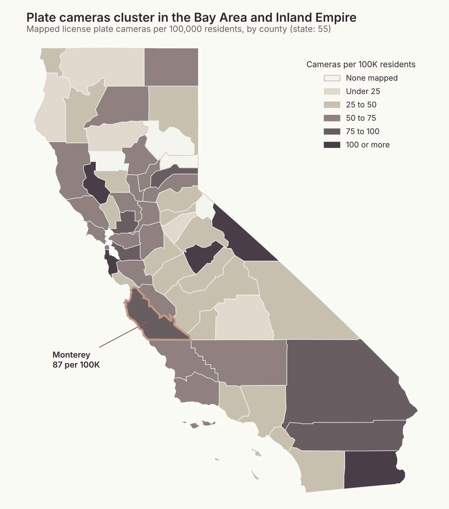
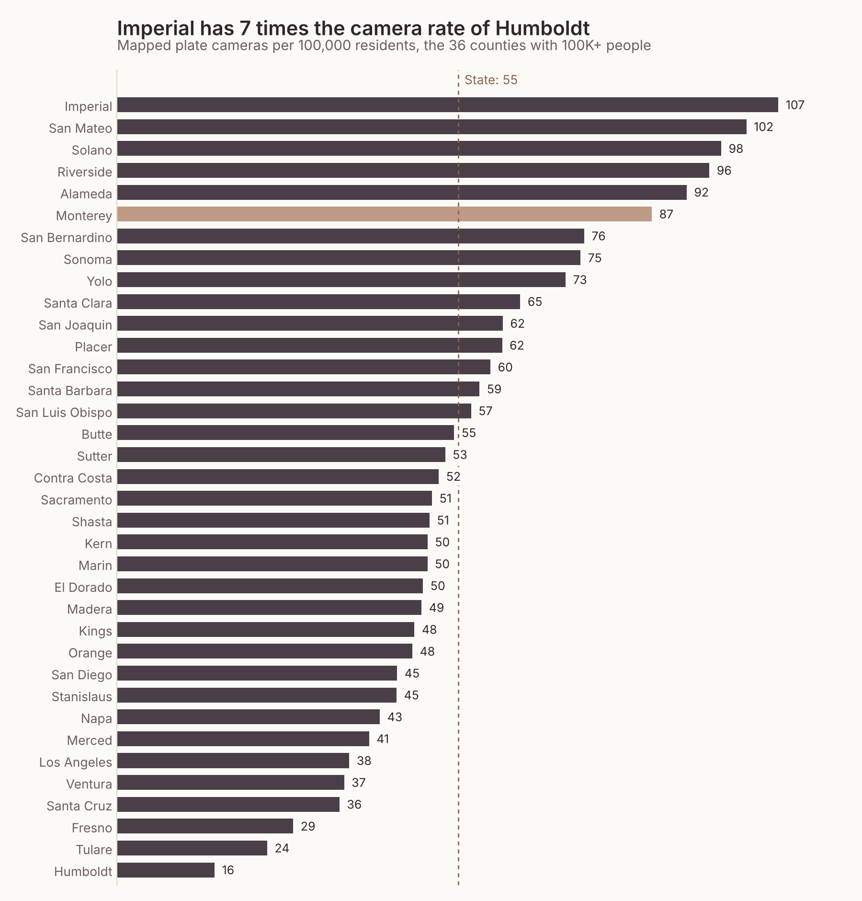
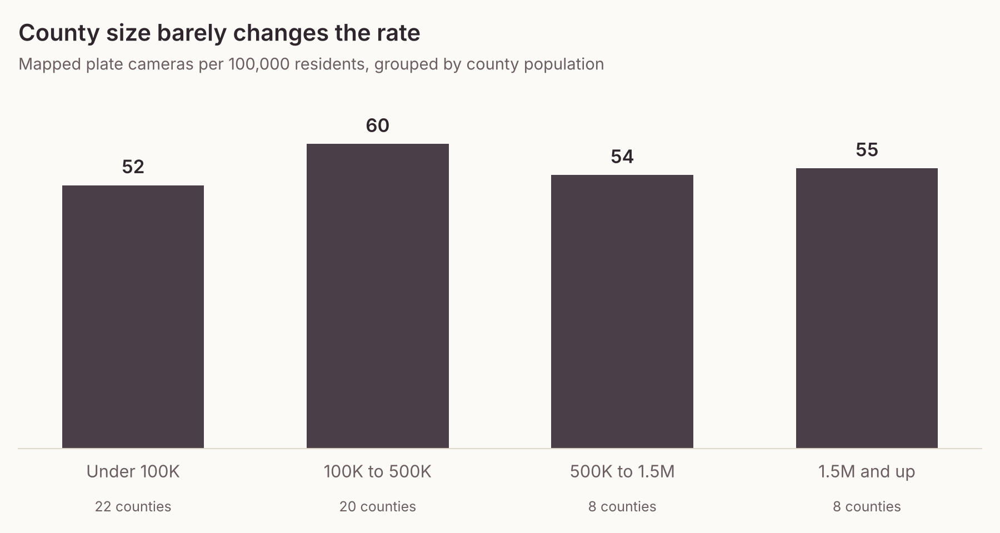
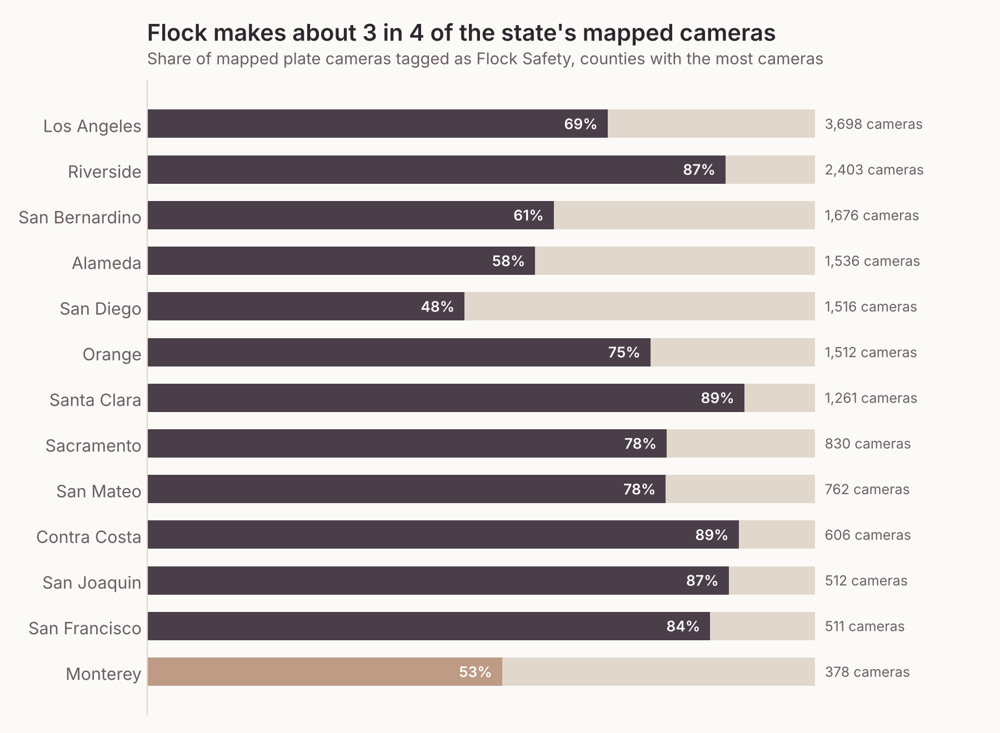
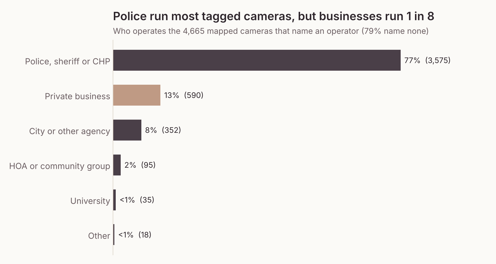

# License Plate Cameras in California: Who Has the Most per Resident?

Automated license plate readers (ALPRs) photograph every passing plate, and Flock Safety has become the biggest name in them. I counted the **21,869** plate cameras that volunteers have mapped across California, matched them to official 2026 county populations, and compared counties per resident.

**The short answer:** large counties range from **16 to 107 cameras per 100,000 people**, and county size barely explains the gap. Local decisions do.



## The question

Cities and counties sign camera contracts one at a time, so nobody has a clear statewide picture. A county board or a local newsroom would want to know:

1. Where are plate cameras most concentrated relative to the people who live there?
2. Does a bigger county simply mean more cameras per person?
3. Who makes these cameras, and who runs them?

## The data

| | |
|---|---|
| **Cameras** | Every [OpenStreetMap](https://www.openstreetmap.org) object in California tagged `surveillance:type=ALPR`, pulled November 18, 2026 with two Overpass queries (in [`queries/`](queries)) run in [overpass turbo](https://overpass-turbo.eu). Camera data © OpenStreetMap contributors, available under the [Open Database License](https://www.openstreetmap.org/copyright). |
| **Population** | California Department of Finance E-1 population estimates for January 1, 2026, all 58 counties (39.6 million people) |
| **Boundaries** | US Census Bureau county outlines (from the [plotly/datasets](https://github.com/plotly/datasets) repository), used only to draw the map |

**Scope.** I worked only with counts and tags. I didn't analyze individual camera locations, and there's no plate or vehicle data anywhere in this project.

**Limits.** Volunteers add these cameras by hand, so a high count can reflect busy mappers as well as many cameras. Treat the numbers as a floor, not an official inventory. Most cameras (79%) don't name an operator.

## Process

I followed the six-step data analysis process: ask, prepare, process, analyze, share, act.

**Collecting**
- Wrote two Overpass QL queries: one counts cameras inside each county boundary, the other lists each camera's manufacturer and operator tags statewide.

**Cleaning**
- Matched OpenStreetMap county names to Department of Finance names (dropping "County" and handling San Francisco as a city-county). All 58 counties matched.
- Cross-checked the two pulls: county counts add up to 21,869, the same as the number of rows in the statewide tag list.
- Found 460 cameras listing the maker as "Flock Group Inc." (Flock's company name) instead of "Flock Safety". Counting both, Flock makes 76% of mapped cameras.
- Grouped thousands of free-text operator names into six types (police, business, city agency, community group, university, other) with keyword rules, fixing misspellings along the way. Cameras that name Flock itself as operator count as unnamed, since the vendor isn't the owner.

**Analyzing**
- Calculated cameras per 100,000 residents for every county and for the state (55).
- Ranked only the 36 counties with at least 100,000 people, since in small counties a handful of cameras swings the rate.
- Grouped counties by population to test whether size predicts the rate.

## Key findings

### 1. Imperial has 7 times the camera rate of Humboldt
Among large counties, Imperial has 107 cameras per 100,000 people and Humboldt has 16. Los Angeles has the most cameras of any county (3,698), but its rate of 38 is below the state's 55. Riverside, next door, has 2.5 times LA's rate.



### 2. County size barely changes the rate
Small rural counties, mid-size counties and the biggest metro counties all land between 52 and 60 cameras per 100,000. The spread happens inside each size group, which points to local decisions (a city council, a sheriff, a store chain) rather than population.



### 3. Flock makes about 3 in 4 mapped cameras, but not everywhere
Flock Safety is tagged on 74% of mapped cameras, with Motorola Solutions a distant second at 8%. Among the counties with the most cameras, Flock's share runs from 89% in Santa Clara and Contra Costa down to 48% in San Diego. Monterey County's rate of 87 is about 1.6 times the state's, while Flock's share there is just 53%.



### 4. Police run most tagged cameras, but businesses run 1 in 8
Only 4,665 cameras name an operator. Of those, 77% belong to police, sheriffs or the California Highway Patrol. Private businesses run 13%, led by home-improvement and big-box stores. City agencies, homeowner associations and universities run the rest.



## Recommendations

1. **Compare counties by rate, not raw count.** Raw totals mostly track population, so Los Angeles looks like the leader when it's below average per resident.
2. **Start policy reviews where the rate is highest.** Imperial, San Mateo, Solano, Riverside and Alameda all top 90 per 100,000, so they're the first places to compare how long data is kept and who it's shared with.
3. **Close the operator gap.** California law (SB 34) requires agencies using plate readers to post a usage and privacy policy, so matching those policies to mapped cameras would fill much of the 79% gap.
4. **Take a closer look at Monterey County.** One of the highest rates in the state and a more mixed set of vendors make it a good candidate for a city-by-city follow-up.

## Tools

- **Overpass QL / overpass turbo:** pulling and counting the OpenStreetMap data
- **Python (pandas):** cleaning, joining and summarizing
- **Python (matplotlib):** charts and the county map

## Repository layout

```
queries/                              the two Overpass QL queries
data/raw/county_counts.csv            cameras per county (query 1)
data/raw/ca_alpr_operators.csv        manufacturer + operator tags, one row per camera (query 2)
data/raw/ca_county_population_2026.csv  DOF E-1 county populations
data/raw/ca_counties.geojson          county outlines for the map
data/processed/                       outputs of the scripts
scripts/parse_exports.py              turns an overpass turbo JSON export into the CSVs above
scripts/analyze_flock.py              joins counts to population, rates per 100K
scripts/operators_flock.py            classifies operators, draws chart 05
scripts/charts_flock.py               draws the map and charts 01-04
charts/                               chart images used above
```

## How to reproduce

```bash
pip install -r requirements.txt
python scripts/analyze_flock.py     # writes data/processed/flock_by_county.csv
python scripts/operators_flock.py   # writes the classified operator file and chart 05
python scripts/charts_flock.py      # writes charts 01-04
```

To refresh the camera data, run the two queries in `queries/` at overpass-turbo.eu, export the results as JSON, and convert them with `scripts/parse_exports.py`. New mapping will change the numbers.

The charts use the Inter font if it's installed and fall back to the default font otherwise.

## Next steps

- Break the counts down by city, so councils can compare themselves with neighbors.
- Track how the map grows using OpenStreetMap's edit history (it records when a camera was mapped, not installed).
- Match operators to the usage policies that agencies post publicly.
